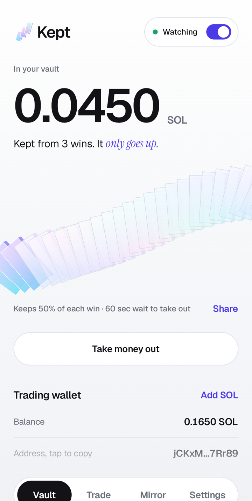
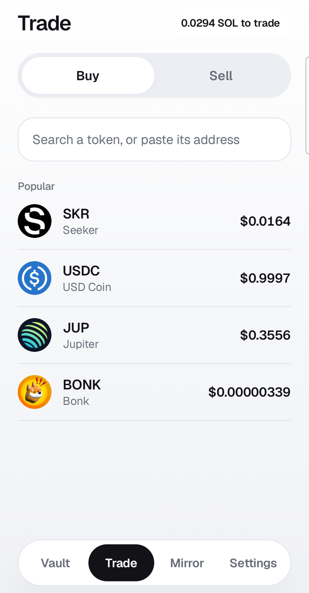
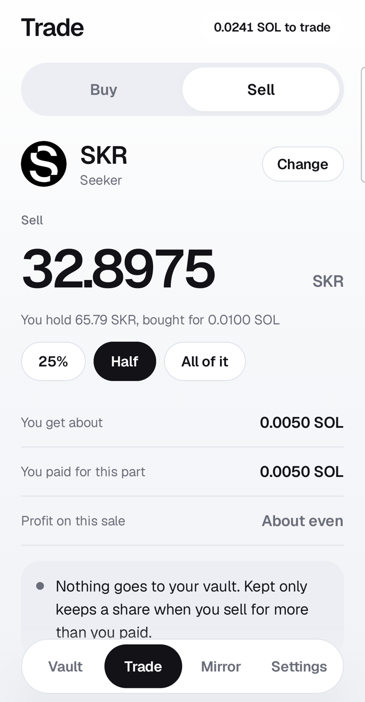
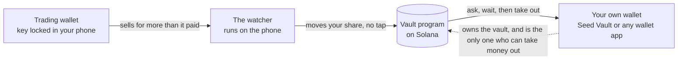

<p align="center">
  
</p>

<h1 align="center">Kept</h1>

<p align="center"><b>You won more than you kept.</b><br>A trading wallet that saves part of every win. Built for Solana Seeker, works on any Android phone.</p>

<p align="center">
  <a href="https://kept-seeker.vercel.app"></a>
  
  
  
  
</p>

<p align="center">
  
  &nbsp;
  
  &nbsp;
  
</p>

Each time your trading wallet sells a token for more than you paid, your phone moves a share of the profit into a vault, by itself, in about two seconds. Money goes into the vault at once. Taking it out means asking, then waiting a time you chose. Wins stop leaking back into the next trade.

## Start here

| | |
|---|---|
| Check any wallet, in a browser | [kept-seeker.vercel.app](https://kept-seeker.vercel.app) |
| See every win kept, read from the chain | [/proof](https://kept-seeker.vercel.app/proof) |
| A five minute tour for judges, no keys needed | [/judges](https://kept-seeker.vercel.app/judges) |
| What Kept does and does not do | [/limits](https://kept-seeker.vercel.app/limits) |
| The vault program on mainnet | [`EWSuJmQA...hyFGK`](https://solscan.io/account/EWSuJmQAHsp5nHsgJzFuaeJxPvJQ9TpkQxN96TDhyFGK) |
| The product requirements | [docs/PRD.md](docs/PRD.md) |
| The build plan, ticked only with proof | [docs/PLAN.md](docs/PLAN.md) |
| The build log, including what broke | [docs/BUILD_LOG.md](docs/BUILD_LOG.md) |

## The problem

Most memecoin traders lose money: 62.5% of pump.fun traders lost, and about 3% made more than $1,000 ([crypto.news](https://crypto.news/over-60-pump-fun-traders-saw-losses-less-than-0-01-made-over-1m/), [Cryptopolitan](https://www.cryptopolitan.com/3-percent-traders-on-pump-fun-made-over-1000/)). Plenty of those traders also have wins. They give them back. The few who stay profitable move profit out of the trading wallet on a schedule ([WalletFinder](https://www.walletfinder.ai/blog/solana-meme-coin-season-wallet-analysis)). Take profit orders do not help: they turn a coin into SOL, and the SOL sits in the same wallet and funds the next buy.

## Check a wallet before you follow it

The Mirror is the front door, in the app and on the site. Paste any Solana wallet, a caller, a dev, a friend or your own, and Kept reads its real trades and says in plain numbers:

- how many of its sales won, and what it made or lost overall
- how much of its winnings it gave back on losing sales
- what a typical win and a typical loss look like, and its biggest single loss
- how many sales could not be priced, so you know how far to trust the read

It ends in one of four plain lines, such as "Wins, and keeps most of it" or "Wins, then gives it all back". The line is chosen by two rules (is it ahead overall, and does it give back more than 35% of what it wins), not by a score. One busy wallet read this way won 149 of 416 sales and lost 11.58 SOL overall. Another won 80 of 111 and made 24.61.

In the app, the check looks back 30 days. Holding 100 SKR looks back 90 days and keeps a list of wallets you watch.

## How it works



1. **The trading wallet** is made on your phone. Its key is sealed by the phone's secure hardware and never leaves unless you reveal it. Trade in the app, or use the same wallet in any other app.
2. **The watcher** follows that wallet. It replays the wallet's history in order, works out what each token cost, and when a sale lands above that cost it signs a transfer of your share by itself. The program accepts that transfer from that one key only, and it can only pay your vault.
3. **The vault** is a Solana program. Money in is instant. To take money out the owner asks, then waits the time they chose. Cancelling is free. Shortening the wait only takes effect after the current wait ends, so a weak moment cannot undo it.
4. **Receipts.** Every win kept is a record on chain tied to the sale that caused it. The proof page reads them straight from the program.

## Trading in the app

Search a token by name or paste its address, pick an amount, buy. To sell, pick from what you hold and type any amount. Before you sell, Kept shows the sum it is about to do: what that part cost you, the profit, and what will go to your vault.

Swaps are routed by Jupiter. Their service is treated as untrusted: every transaction it returns is parsed on the phone and refused before signing unless it is a plain swap for this wallet that spends no more than you asked ([`SwapValidator.kt`](android/app/src/main/java/app/kept/trade/SwapValidator.kt), tested against real swap transactions and hand built hostile ones).

## SKR

- **Keep wins as staked SKR.** Your share of a win is swapped to SKR and staked with Solana Mobile's staking program in the vault's name. Only the Kept program, after the vault's wait, can unstake it. Kept only ever stakes the SKR it just bought, never SKR you hold yourself.
- **The holder tier.** Hold 100 SKR in your own wallet to choose your share of each win, keep wins as staked SKR, look back 90 days in the wallet check, and keep a watch list. Without it the share is 50%, kept as SOL, and the check looks back 30 days.

## What is proven, and what is not

Everything in the left column was run for real. Nothing is claimed that was not seen.

| Part | Status |
|---|---|
| Vault program | **Live on mainnet** at the same address as devnet. Written without a framework: 44,992 bytes, so the deposit to deploy it was 0.23 SOL. The bytes on chain hash to the tested build. 27 simulator tests, including attacks and the SKR path against the real mainnet staking program |
| Setup on a real phone, mainnet | **Proven.** Samsung Galaxy S22 Ultra with Phantom: connect, open the vault, add SOL to the trading wallet |
| Buying and selling in the app, mainnet | **Proven.** Real swaps through the validator. A sale at a loss moved nothing to the vault, as designed |
| Keeping a win | **Proven on devnet on the same phone:** wins were kept about two seconds after each winning sale, with no tap, and a loss was skipped. Not yet seen on mainnet, because that needs a real winning sale |
| Taking money out | **Proven on devnet** on the emulator: ask, wait, take out, cancel. Not yet run on mainnet |
| Keeping wins as staked SKR | Tested against the real staking program in the simulator. Not yet run on mainnet |
| Seed Vault on a Seeker | **Not tested.** No Seeker was available. The app speaks standard Mobile Wallet Adapter, which is what the Seed Vault wallet uses |
| Mirror and proof page | Live. The Mirror reads a busy wallet in about 14 seconds |
| Profit sums | Real mainnet transactions, checked against an independent parser. The phone and the site run the same test vectors |

## Why only here

The watcher needs a key it can use without asking, held where no server can reach it, and a vault that only the owner's own wallet controls. A Seeker has both in one device: the Seed Vault for the owner, the phone's secure hardware for the watcher, and SKR to make the vault earn while it waits.

## The business in one number

Keeping a win costs one network fee, 5,000 lamports. Kept takes nothing from a win.

## Run it yourself

```bash
# profit engine, shared test vectors
cd engine && npm test

# vault program, in WSL or Linux with the Solana toolchain
./run-program-tests.sh

# Android (JDK 17, Android SDK)
cd android && ./build-with-retry.sh :app:testDebugUnitTest
./build-with-retry.sh :app:assembleDebug

# site
cd web && npm install && npm test && npx next build
```

The default Android build targets devnet. A mainnet build must be asked for on purpose: `-Pkept.cluster=mainnet-beta -Pkept.enableMainnet=true`.

## Scope and limits

The plain language version is on the site at [/limits](https://kept-seeker.vercel.app/limits). The details:

- **A wallet you hold the key to can always move its own money.** Kept does not stop you moving funds out of the trading wallet by hand. It protects what is already in the vault.
- **A win is kept only when the wallet sells for more than it paid.** Tokens that arrived some other way, such as an airdrop, have no cost and are never counted. Cost is an average over the buys the app has seen. The small deposit a token account needs is counted as part of what you paid.
- **The watcher runs while the phone is on and the app is allowed to run.** If it was stopped, it catches up from the wallet's history when it wakes and marks those as found late.
- **Each request to your wallet app starts with its connect screen.** A wallet app that has just been opened turns down a remembered login, so Kept asks fresh every time. It costs one extra tap and it always works.
- **Mirror numbers are a plain sum.** The kept figure ignores how keeping part of each win would have changed your later trade sizes.
- **New software.** The program is open source and tested, and has had no outside audit.
- **Cut from the first plan:** rules per token and several trading wallets for SKR holders. They were never needed to prove the core claim.

## Layout

| Path | What |
|---|---|
| `programs/kept_vault` | The vault program and its simulator tests |
| `engine` | The profit engine and the real transaction vectors |
| `android` | The app: Kotlin, Compose, Mobile Wallet Adapter |
| `web` | The site, the key protecting RPC proxy, the history route and the proof page |
| `scripts` | Devnet smoke and end to end scripts |

## Credits

Typefaces: Geist, Geist Mono and Instrument Serif, all under the SIL Open Font License. Built for the CLOCK IN Solana Mobile hackathon.

## License

MIT. See [LICENSE](LICENSE).
