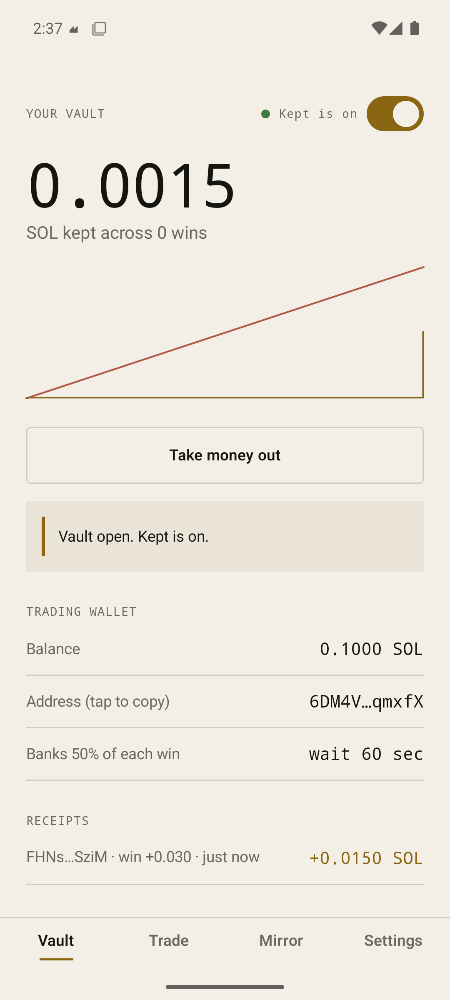
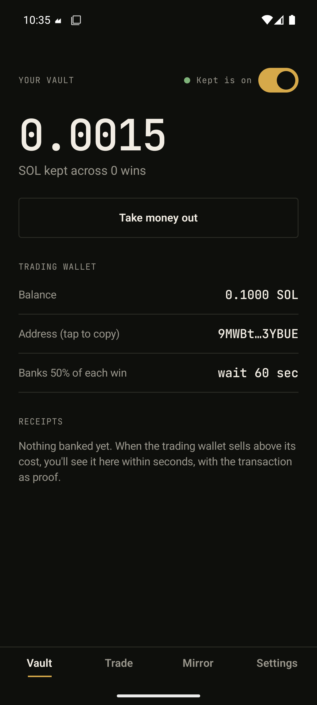
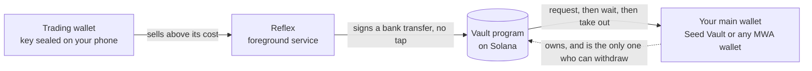

<p align="center">
  
</p>

<h1 align="center">Kept</h1>

<p align="center"><b>You won more than you kept.</b><br>A trading wallet with a reflex, built for Solana Seeker.</p>

<p align="center">
  <a href="https://kept-seeker.vercel.app"></a>
  
  
  
  
</p>

<p align="center">
  
  &nbsp;&nbsp;
  
</p>

Each time your trading wallet sells for a profit, your phone signs a transfer on its own and moves your share of the profit into a vault. Money goes into the vault instantly. Getting it out takes a wait you chose. Wins stop leaking back into the next trade.

## Start here

| | |
|---|---|
| Try it on any wallet in a browser | [kept-seeker.vercel.app](https://kept-seeker.vercel.app) |
| See every bank, read from the chain | [/proof](https://kept-seeker.vercel.app/proof) |
| Five minutes, no keys | [/judges](https://kept-seeker.vercel.app/judges) |
| The product requirements | [docs/PRD.md](docs/PRD.md) |
| The build plan, ticked only with proof | [docs/PLAN.md](docs/PLAN.md) |
| What was proven before building | [docs/spikes/core-assumptions.md](docs/spikes/core-assumptions.md) |

## The problem

Most memecoin traders lose money: 62.5% of pump.fun traders lost, and about 3% made more than $1,000 ([crypto.news](https://crypto.news/over-60-pump-fun-traders-saw-losses-less-than-0-01-made-over-1m/), [Cryptopolitan](https://www.cryptopolitan.com/3-percent-traders-on-pump-fun-made-over-1000/)). Plenty of those traders also have wins. They just give them back. The few who stay profitable move profit out of the trading wallet on a schedule ([WalletFinder](https://www.walletfinder.ai/blog/solana-meme-coin-season-wallet-analysis)). Take profit orders do not help: they turn a coin into SOL, and the SOL stays in the same wallet and funds the next buy.

Paste any wallet into the Mirror on the site to see its own numbers. On one busy public wallet, last 90 days: 123 winning sells worth 12.77 SOL, and 28.05 SOL given back on losing ones. Half of those wins, banked, would have been 6.38 SOL sitting in a vault.

## How it works



1. **The trading wallet** is made on your phone. Its key is sealed with an Android Keystore key and never leaves the phone. Trade in the app, or import the wallet into Phantom.
2. **The reflex** watches the wallet. It replays the wallet's history in order, works out the cost of each coin, and when a sell lands above that cost it signs a `bank` instruction itself. The program accepts it only from that one key, and it can only pay the vault.
3. **The vault** is a Solana program. Money in is instant. To take money out the owner asks, then waits the time they chose. Cancelling is free. Shortening the wait only takes effect after the current wait ends, so a bad moment cannot talk you out of it.
4. **Receipts.** Every bank is an event on chain tied to the sell that caused it. The proof page reads them straight from the program.

## SKR

SKR is used for something that needs it:

- **Bank into staked SKR.** The share of a win is swapped to SKR and staked with Solana Mobile's staking program in the vault's name. Only the Kept program, after the vault's wait, can unstake it. Getting it out is three steps: ask, unstake, then collect after SKR's own two day period.
- **The holder tier.** Hold 100 SKR in your main wallet to choose your own share of each win, and to bank into staked SKR. Without it the share is a fixed 50% in SOL.

## What is real and what is not

| Part | Status |
|---|---|
| Vault program (Anchor 1.2) | Deployed on devnet. Same program id on mainnet, deployed at the end. 11 simulator tests, including against the real mainnet SKR staking program |
| Profit engine | Real mainnet transactions, checked against an independent parser. TypeScript and Kotlin run the same test vectors |
| Reflex | Verified on devnet on an emulator: a real buy and a real profitable sell on the trading wallet were banked at 50% of the profit, about two seconds after the sell, with no tap |
| Wallet signing | Verified against Solana Mobile's reference wallet over a real Mobile Wallet Adapter association. Seed Vault on a Seeker is not tested, because no Seeker was available |
| Withdraw, wait, cancel | Verified on the emulator against devnet |
| Mirror and proof page | Live. The Mirror reads a busy wallet in about 14 seconds |
| Swapping in the app | Written against Jupiter. Needs mainnet, so it is tested at the end |
| SKR banking | Written and unit tested. Needs mainnet and real SKR, so it is tested at the end |

## Why only here

The reflex needs a key it can use without asking, held where no server can reach it, and a vault the owner's hardware wallet controls. A Seeker has both: the Seed Vault for the owner, the phone's keystore for the reflex, and SKR to make the vault earn while it waits.

## The business in one number

Each bank costs one network fee, 5,000 lamports. Kept takes nothing from a win.

## Run it yourself

```bash
# profit engine, shared test vectors
cd engine && npm test

# vault program, in WSL or Linux with the Solana toolchain
anchor build --arch v0 && cargo test -p kept_vault

# Android (JDK 17, Android SDK)
cd android && ./build-with-retry.sh :app:testDebugUnitTest
./build-with-retry.sh :app:assembleDebug

# site
cd web && npm install && npm test && npx next build
```

## Scope and limits

- **A wallet you hold the key to can always move its own money.** Kept does not stop you moving funds out of the trading wallet by hand. It protects what has been banked.
- **A win is banked only when the wallet sells above its cost.** Coins with no known cost, such as an airdrop, are never banked. Cost is an average over the buys the app has seen. Account rent on token accounts is counted as part of cost and proceeds.
- **The reflex runs while the phone is on and the service is alive.** If it was stopped, it catches up from the wallet's history when it wakes and labels those banks as found late.
- **Approvals must be quick.** A transaction a wallet app is asked to sign is only valid for about a minute. A slow approval is rejected by the network, and the app says so.
- **Mirror numbers are a plain sum.** The "kept" figure ignores how banking would have changed your later trade sizes.
- **Domain verification for wallet apps** is set up (an `assetlinks.json` for the release signing key), but the one reference wallet tried did not accept it, so some wallets may show Kept as unverified.
- **Cut from the first plan:** per coin rules and several trading wallets for SKR holders. They were never needed to prove the core claim.

## Layout

| Path | What |
|---|---|
| `programs/kept_vault` | The vault program and its simulator tests |
| `engine` | The profit engine and the real transaction vectors |
| `android` | The app: Kotlin, Compose, Mobile Wallet Adapter |
| `web` | The site, the key protecting RPC proxy, the bulk history route and the proof page |
| `scripts` | Devnet smoke and end to end scripts |

## Credits

Typefaces: Fraunces and JetBrains Mono, both under the SIL Open Font License. Built for the CLOCK IN Solana Mobile hackathon.

## License

MIT. See [LICENSE](LICENSE).
